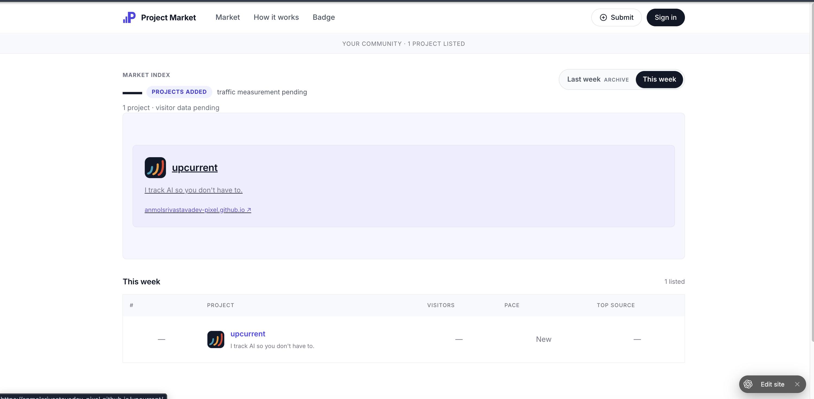

# Project Market

A clean market for launching and discovering projects — submit a project, get a card with its website logo, and appear in the weekly rankings.

**Live:** https://proof-of-traction-copy.anmol-srivastava-dev.chatgpt.site



## Features

- Persistent project submissions (stored server-side via the `/api/` worker)
- Automatic project logos pulled from each project's website
- Market index card view and weekly ranking table
- Static pages: About, Methods, Badge, Privacy

## Structure

```
public/          static site (HTML, CSS, JS, fonts, images)
worker/api.js    API handlers for project submissions
scripts/build.mjs bundles public/ + worker into dist/server/index.js
marketing/       launch video and product screenshot
```

## Build

```bash
node scripts/build.mjs
```

Outputs a single Worker bundle at `dist/server/index.js`.

## Marketing

[`marketing/project-market-launch.mp4`](marketing/project-market-launch.mp4) — 16s, 1080p launch video.
